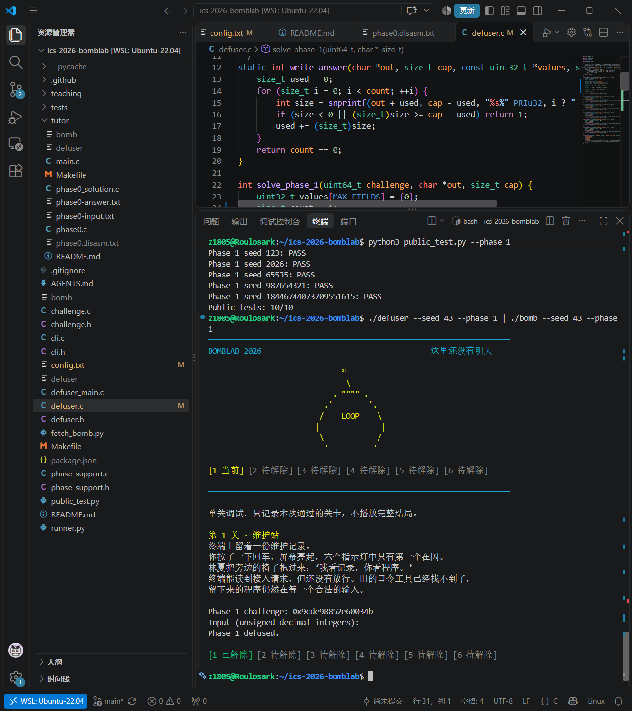
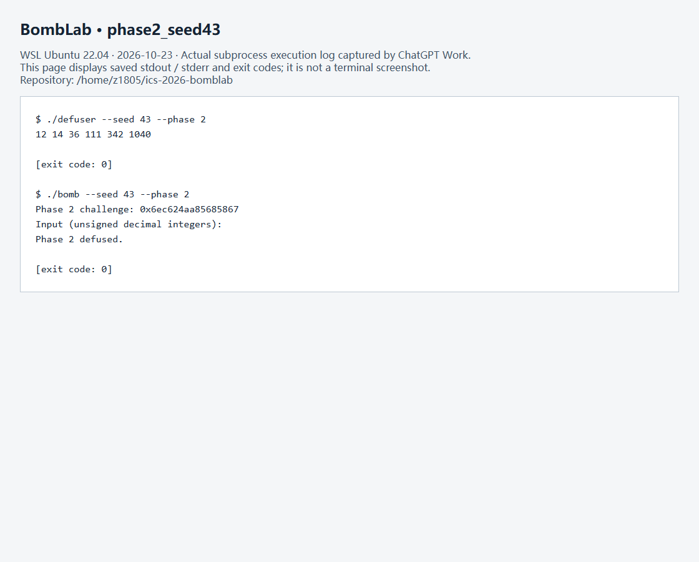
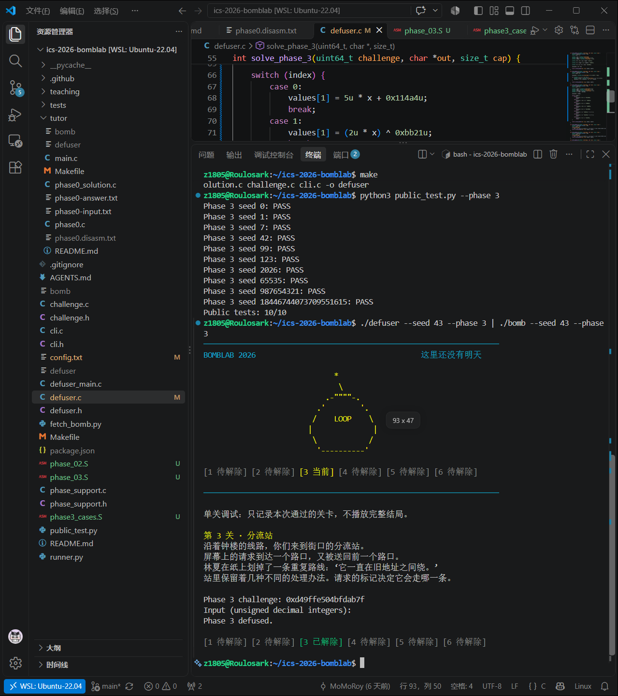
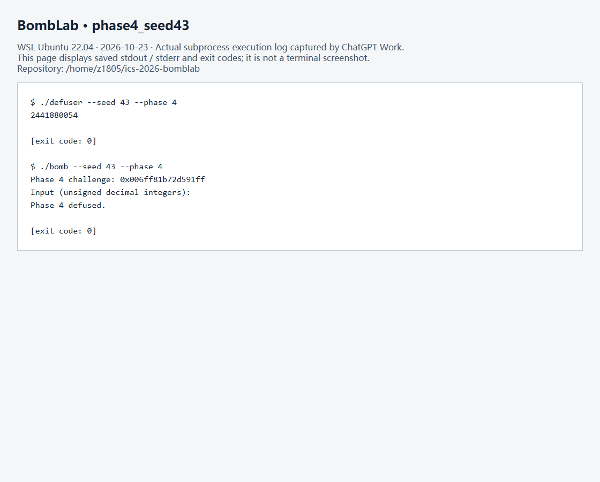
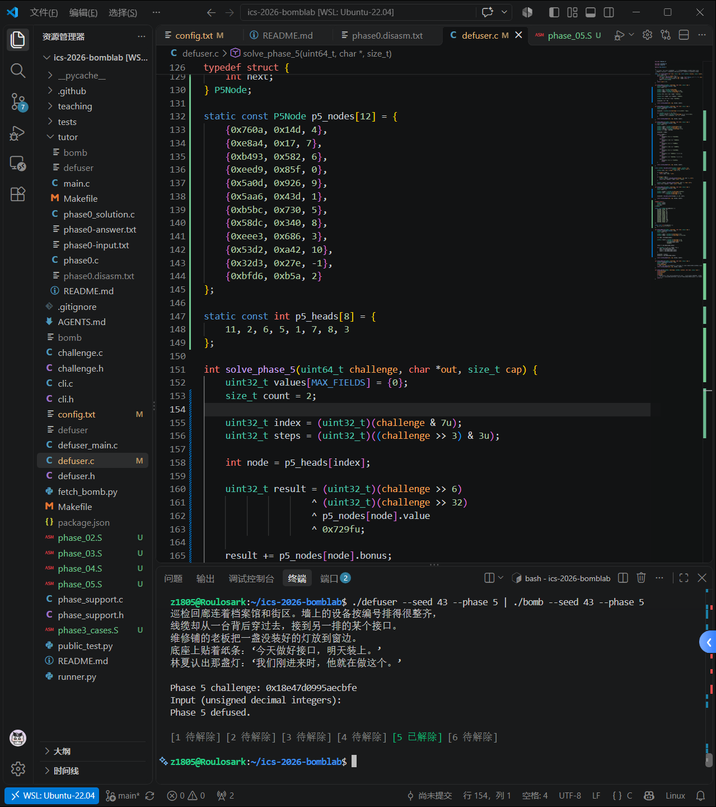
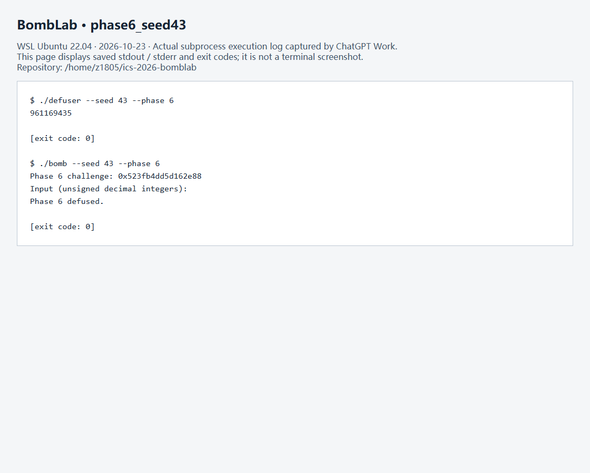
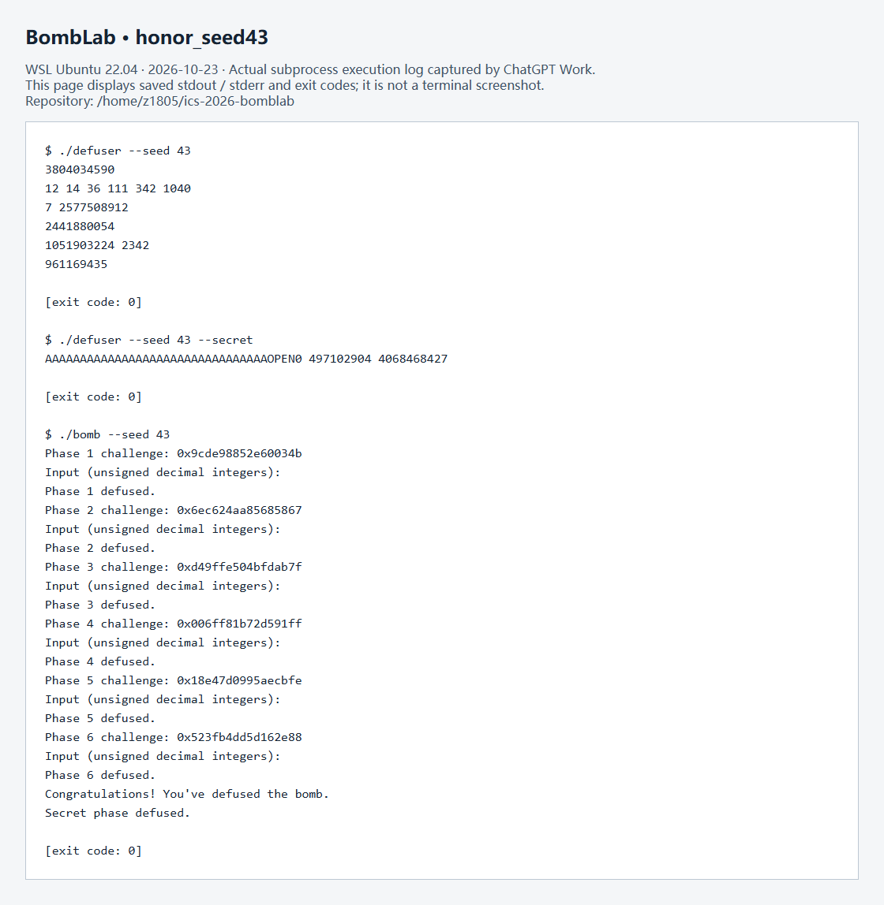
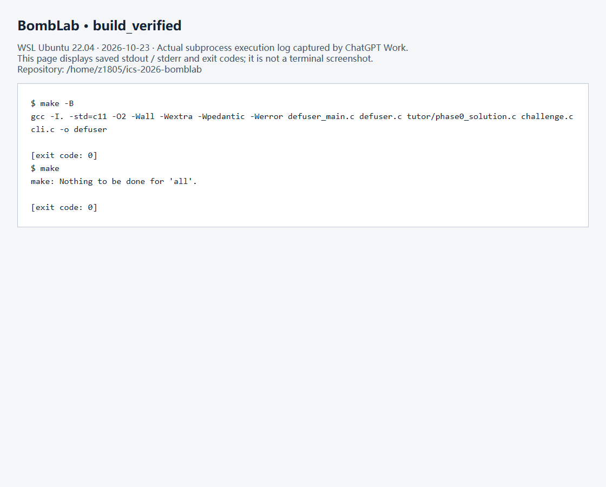
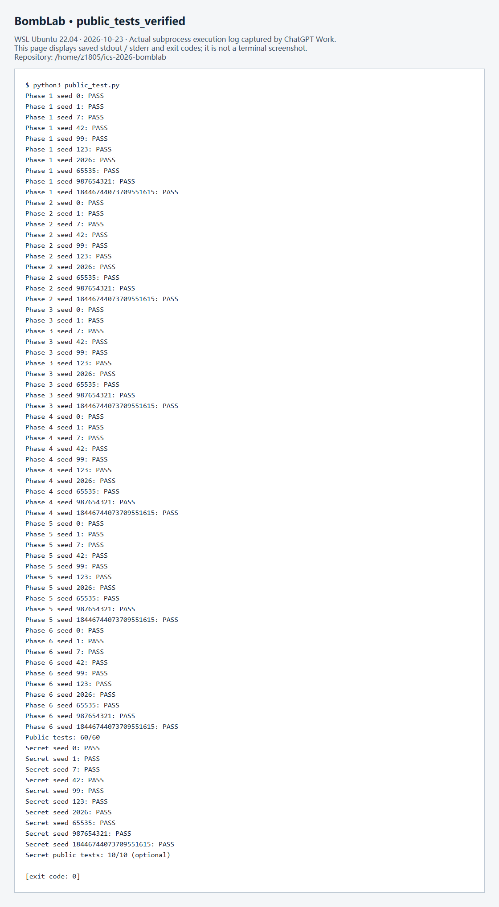
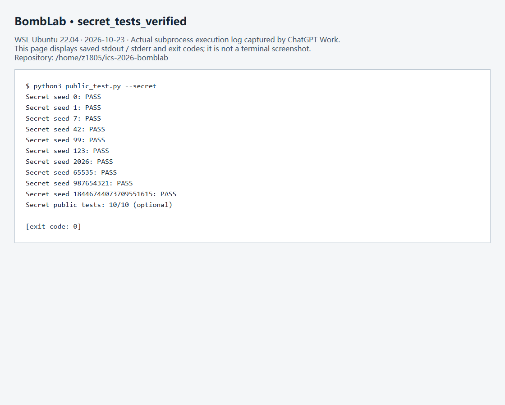

# ICS 2026 Fall · Lab 2 BombLab 实验报告

> 本报告基于已有解法与历史材料，经 2026-10-23 ChatGPT Work 在本机 WSL 中重新核对反汇编、重新编译并执行测试后修订。本次自动验证与历史人工实验分别说明；测试结果不代表隐藏测试保证。

## 1. 实验概况

- **环境**：Windows + WSL 2（Ubuntu 22.04，Linux x86-64）；Visual Studio Code。
- **工具**：GCC、GNU Make、GNU GDB、`objdump` / `nm`、Python 3、Git。
- **任务**：逆向个人 `bomb`，在 `defuser.c` 中实现 Phase 1–6 与选做 Honor 的求解函数；根据每次的 `challenge`（Honor 还包含 `context`）动态生成正确的输出。
- **本次重新执行的公开测试结果**：正式六关 `60/60 PASS`；Honor `10/10 PASS`。这些是公开样例的结果，不能替代助教的隐藏测试。

本实验的核心方法是定位验证函数，按照 System V AMD64 调用约定辨认参数，结合 `cmp` / `jcc` 恢复成功分支的约束，再将关键算术、控制流或数据结构还原为 C 语言。特别注意 `%eax`、`%edx` 等 32 位寄存器对应的运算通常应使用 `uint32_t`，使溢出按模 `2^32` 回绕。

## 2. Phase 1：函数调用与运算组合

**目标**：从 64 位 `challenge` 计算一个 32 位无符号整数。

主函数在验证输入字段数目后调用 `p1_compute`，其内部再依次调用 `p1_step0`、`p1_step1`、`p1_step2`。关键指令如下（只列计算部分）：

```asm
# p1_step0
lea    (%rdi,%rdi,4),%eax
add    %esi,%eax
xor    $0x5721,%eax

# p1_step1
lea    (%rdi,%rsi,2),%eax
xor    $0x89e7,%eax

# p1_step2
xor    $0x1470,%esi
lea    (%rsi,%rdi,4),%eax
```

设 `C = challenge`，并定义：

```c
uint32_t low  = (uint32_t)C;
uint32_t high = (uint32_t)(C >> 32);
uint32_t mid  = (uint32_t)(C >> 16);
```

对应的计算关系为：

```c
uint32_t t0 = (5u * low + high) ^ 0x5721u;
uint32_t t1 = (high + 2u * mid) ^ 0x89e7u;
uint32_t t2 = 4u * t1 + (low ^ 0x1470u);
uint32_t answer = t2 ^ t0;
```

这里 `lea` 并不一定用于取地址：如 `(%rdi,%rdi,4)` 可直接完成 `5 * rdi` 的整数运算。`p1_compute` 最后执行 `xor %ecx,%eax`，把中间结果组合成最终口令。由于三个辅助函数使用 32 位目标寄存器，C 实现也应使用 32 位无符号类型。

**非公开 seed 验证（历史截图已确认 `Phase 1 defused.`）**：

```bash
./defuser --seed 43 --phase 1 | ./bomb --seed 43 --phase 1
```

本次重测也确认成功标志：`Phase 1 defused.`



## 3. Phase 2：循环、数组与递推

**目标**：计算六个整数，验证函数用循环逐项比较。

关键汇编：

```asm
shr    $0x4,%rdx
and    $0x7f,%edx
xor    $0xa,%edx
cmp    %edx,%eax         # 比较第一项

add    %ecx,%eax         # 上一项 + i
add    $0x1,%ecx
shr    %cl,%rdi          # challenge >> (i+1)
lea    (%rax,%rax,2),%esi # 3 * (上一项+i)
mov    -0x4(%rdx),%eax  # 装入当前输入项
and    $0x1f,%edi
sub    %edi,%esi
cmp    %esi,%eax         # 比较当前项
```

第一项从 `challenge` 的第 4 位开始取 7 位，再异或常量：

```c
uint32_t a[6];
a[0] = (uint32_t)((C >> 4) & 0x7fu) ^ 0xau;
```

其余各项满足：

```c
for (uint32_t i = 1; i < 6; ++i) {
    uint32_t offset = (uint32_t)((C >> (i + 1)) & 31u);
    a[i] = 3u * (a[i - 1] + i) - offset;
}
```

分析时的关键是确认 `ecx` 的增长顺序：本轮先将 `i` 加到上一项，再将计数器加一以作为右移位数。因此右移量是 `i + 1`，而递推求和部分使用 `i`。这类次序若看错，会导致所有后续项偏移。

**非公开 seed 43：本次实际运行成功，求解器与炸弹均返回 0，输出 `Phase 2 defused.`。**

```bash
set -o pipefail
./defuser --seed 43 --phase 2 | ./bomb --seed 43 --phase 2
```



## 4. Phase 3：switch 与跳转表

**目标**：输出两个整数。第一个选择分支，第二个由分支函数计算。

`phase_03` 中的主要约束为：

```asm
and    $0x7,%edi
cmp    %edi,-0x18(%rbp)      # 第一项 = challenge 低三位
shr    $0x3,%rax
shr    $0x20,%rsi
xor    %eax,%esi              # 构造分支运算参数
call   4021c0 <p3_dispatch>
cmp    %eax,-0x14(%rbp)      # 比较第二项
```

令：

```c
uint32_t index = (uint32_t)(C & 7u);
uint32_t x = (uint32_t)(C >> 3) ^ (uint32_t)(C >> 32);
```

`p3_dispatch` 通过 `jmp *0x4057e0(,%rax,8)` 查表间接跳转。读取八个表项并跟踪跳转桩后，将 **表索引** 和 **函数名称编号** 分开记录（两者不是同一顺序）：

| `index` | 最终跳转目标（经跳转桩） | 对应输出 `f(x)`（`uint32_t`） |
|---:|---|---|
| 0 | `p3_case_5` | `5u*x + 0x114a4u` |
| 1 | `p3_case_0` | `(2u*x) ^ 0xbb21u` |
| 2 | `p3_case_1` | `3u*x + 0xd0d1u` |
| 3 | `p3_case_6` | `(4u*x) ^ 0x989fu` |
| 4 | `p3_case_3` | `5u*x + 0x178e0u` |
| 5 | `p3_case_7` | `(x ^ 0x925cu) + (x >> 1)` |
| 6 | `p3_case_2` | `(x ^ 0x41fbu) + (x >> 1)` |
| 7 | `p3_case_4` | `3u*x + 0xc873u` |

最终口令是 `index f(x)`。这一关的重要经验是：不能看到 `case_0` 就认为它对应输入索引 0，必须读取实际跳转表。

**非公开 seed 验证（历史截图已确认 `Phase 3 defused.`）**：

```bash
./defuser --seed 43 --phase 3 | ./bomb --seed 43 --phase 3
```



## 5. Phase 4：递归与返回值编码

**目标**：通过递归二分定位目标，同时计算沿途路径的编码结果。

`phase_04` 的调用参数可恢复为：

```c
uint32_t target = (uint32_t)(C & 0x7fu);
uint32_t salt = (uint32_t)(C >> 7) ^ (uint32_t)(C >> 32);
// p4_walk(target, 0, 127, salt)
```

核心汇编：

```asm
sub    %esi,%edi
shr    %edi
add    %esi,%edi          # mid = low + ((high-low)>>1)
cmp    %eax,%edi
je     402300
cmp    %edi,%eax         # 第二次比较：target - mid
jb     4022e0             # target < mid
...
call   4022a0 <p4_walk>
lea    (%rax,%rax,4),%eax # 5 * child_result
xor    %ebx,%eax
xor    $0x1f,%eax        # 右子树
...
4022f4: xor $0x12,%eax   # 左子树
402300: lea 0x1e(%rdi),%eax
402303: xor %ecx,%eax
```

恢复成递归关系（所有结果为 32 位无符号值）：

```c
uint32_t mid = low + ((high - low) >> 1);
if (target == mid)
    return (mid + 30u) ^ salt;
if (target < mid) {
    uint32_t child = walk(target, low, mid - 1, salt);
    return (5u * child) ^ (mid + salt) ^ 0x12u;
}
uint32_t child = walk(target, mid + 1, high, salt);
return (5u * child) ^ (mid + salt) ^ 0x1fu;
```

`jb` 是无符号的“小于”跳转。递归解题时需要同时看清**递归参数如何缩小搜索区间**和**函数返回后又对结果施加哪些操作**。只把它视作普通二分搜索，会漏掉回溯阶段的乘 5 和异或操作。

**非公开 seed 43：本次单关运行成功，求解器与炸弹均返回 0，输出 `Phase 4 defused.`。**

```bash
set -o pipefail
./defuser --seed 43 --phase 4 | ./bomb --seed 43 --phase 4
```



## 6. Phase 5：结构体、指针与链表遍历

**目标**：从 `challenge` 确定链表起点、遍历步数，并生成两个整数。

`p5_traverse` 的关键指令：

```asm
and    $0x7,%eax
mov    0x405b20(,%rax,8),%rdx # 根据低三位选择头指针
mov    0x4(%rdx),%esi        # node->bonus
xor    (%rdx),%eax          # node->value
mov    %esi,(%r8)           # 写出第二个结果
mov    0x8(%rdx),%rdx       # node = node->next
mov    0x4(%rdx),%esi       # 读取新节点 bonus
xor    (%rdx),%eax
add    %esi,%eax
```

节点在内存中前四字节为 `value`，后四字节为 `bonus`，偏移 8 处是一个 64 位 `next` 指针。求解器里将指针引用的节点转换为数组下标后，可使用结构：

```c
typedef struct {
    uint32_t value;
    uint32_t bonus;
    int next;
} P5Node;
```

这里 `next` 是求解器使用的**数组索引**，不是原二进制里指针字段的原始表示。可用 GDB 的 `x/8gx 0x405b20` 找头指针，再用 `x/2uw` 和 `x/gx` 检查节点字段。本次 Work 直接读取个人 bomb 的 `.rodata`，逐项核对了 12 个节点的 value、bonus、next 地址以及 8 个头指针；地址转换成数组索引后与现有源码一致。

令：

```c
uint32_t index = (uint32_t)(C & 7u);
uint32_t steps = (uint32_t)((C >> 3) & 3u);
int node = p5_heads[index];

uint32_t result = (uint32_t)(C >> 6)
                ^ (uint32_t)(C >> 32)
                ^ p5_nodes[node].value ^ 0x729fu;
result += p5_nodes[node].bonus;

for (uint32_t i = 0; i < steps; ++i) {
    node = p5_nodes[node].next;
    result ^= p5_nodes[node].value;
    result += p5_nodes[node].bonus;
}
// 输出：result, p5_nodes[node].bonus
```

核对得到的头节点索引依次为：`{11, 2, 6, 5, 1, 7, 8, 3}`。实际节点表保存在 `defuser.c` 的 `p5_nodes` 中，报告不重复抄录全部结构体常量；本次已与个人 bomb 的只读数据逐项核对。

**非公开 seed 验证（历史截图已确认 `Phase 5 defused.`）**：

```bash
./defuser --seed 43 --phase 5 | ./bomb --seed 43 --phase 5
```



## 7. Phase 6：函数指针表与间接调用

**目标**：按 `challenge` 指定的两个函数指针，依次变换同一个 32 位值。

`p6_dispatch` 中的核心调用为：

```asm
shr    $0x6,%rdi
shr    $0x20,%rax
xor    %eax,%edi
and    $0x38,%ebx
and    $0x7,%eax
call   *0x405dc0(,%rax,8) # 第一次间接调用
xor    $0x810c,%eax
mov    %eax,%edi
call   *0x405dc0(%rbx)    # 第二次间接调用
add    $0x669a,%eax
```

定义：

```c
uint32_t x = (uint32_t)(C >> 6) ^ (uint32_t)(C >> 32);
uint32_t i = (uint32_t)(C & 7u);
uint32_t j = (uint32_t)((C >> 3) & 7u);
```

通过 `x/8gx 0x405dc0` 可读出函数指针表；本次也直接核对了 `.rodata` 中的八个地址，其顺序为：

| 表索引 | 函数 |
|---:|---|
| 0 | `p6_op_0` |
| 1 | `p6_op_1` |
| 2 | `p6_op_3` |
| 3 | `p6_op_3` |
| 4 | `p6_op_2` |
| 5 | `p6_op_2` |
| 6 | `p6_op_4` |
| 7 | `p6_op_5` |

各函数由独立反汇编还原：

| 函数 | 32 位运算 `op(x)` |
|---|---|
| `p6_op_0` | `ROR32(x, 5)` |
| `p6_op_1` | `(x + 0xb5ceu) ^ (x >> 7)` |
| `p6_op_2` | `(x ^ 0x848fu) + 2u*x` |
| `p6_op_3` | `ROL32(x, 3) ^ 0x76bdu` |
| `p6_op_4` | `((x >> 1) ^ x) + 0xa608u` |
| `p6_op_5` | `(2u*x + 0x998u) ^ (5u*x)` |

因此最终答案为：

```c
uint32_t first = op[i](x);
uint32_t second = first ^ 0x810cu;
uint32_t answer = op[j](second) + 0x669au;
```

这一关需要特别区分“函数代码地址”和“函数表位置”。`call *...` 中的星号表示**读取内存中保存的目标地址并进行间接调用**，并非直接跳到表本身。

**非公开 seed 43：本次单关运行成功，求解器与炸弹均返回 0，输出 `Phase 6 defused.`。**

```bash
set -o pipefail
./defuser --seed 43 --phase 6 | ./bomb --seed 43 --phase 6
```



## 8. Honor / Secret Phase：外层字符串协议与内部计算

**目标**：使用 `challenge` 和由前六行口令得到的 `context`，生成一整行 ASCII 文本。该关是选做的 10 分加分项。

### 8.1 起初失败的原因：只分析了内部函数

历史材料记录了只输出三个整数时的失败；本次未复现旧版失败，核查以现有代码和实际调用链为准。`secret_phase` 解析三个整数，但完整调用链还包括外层格式检查：

```text
main -> secret_gate -> secret_copy -> secret_phase -> secret_mix
```

`secret_gate` 有两道前置检查：

```asm
call   0x401190              # strlen
sub    $0x24,%rax
cmp    $0x7f,%rax
jbe    0x4026e0               # 要求 36 <= 长度 <= 163
...
call   402660 <secret_copy>
cmpl   $0x4e45504f,-0xb0(%rbp)
jne    4026cb                 # 检查偏移 32 的 OPEN
lea    -0xac(%rbp),%rdi       # 内部验证从偏移 36 开始
call   4025a0 <secret_phase>
```

`secret_copy` 逐字节复制到 `\0` 为止。因此合法口令的整体布局为：

| 字节偏移 | 内容 |
|---|---|
| 0–31 | 32 个 ASCII 填充字符，例如 `A` |
| 32–35 | 固定的 `OPEN` |
| 36 起 | 以空格分隔的三个无符号十进制整数 |

这里 `0x4e45504f` 按 x86-64 小端序存入内存恰好对应 `OPEN`。因此数值计算和外层字符串格式都必须满足。长度检查使用无符号比较，`strlen - 36 <= 127` 等价于长度在 36–163 字节之间；前三十二字节的 `A` 是填充选择，固定标记是偏移 32 处的 `OPEN`。

### 8.2 三个整数的计算

设 `C = challenge`、`K = context`，定义：

```c
uint32_t a = (uint32_t)(K & 3u);
uint32_t u = (uint32_t)(C >> 32) ^ (uint32_t)C;
uint32_t v = (uint32_t)(K >> 32) ^ (uint32_t)K;
uint32_t r = (a * 0x260au) ^ (uint32_t)(K >> 16);
```

`secret_mix` 的关键指令是：

```asm
rol    $0x3,%eax
add    $0x260a,%eax
xor    $0xf938,%eax
```

因此可定义：

```c
uint32_t mix(uint32_t x) {
    return (((x << 3) | (x >> 29)) + 0x260au) ^ 0xf938u;
}
uint32_t b = mix(u ^ v) ^ r;
uint32_t c = b ^ (v + a + 0xf938u + (u >> 3));
```

最终用 32 个 `A`、`OPEN` 和 `a b c` 拼接成一行，检查 `cap` 容量，成功时返回 0。此处必须在 `defuser.c` 引入 `<string.h>` 才能调用 `memset` / `memcpy`；实验启用 `-Werror`，遗漏声明会直接导致编译失败。

### 8.3 调试经验

历史材料提到输入文件混入终端控制序列、缺少 `<string.h>` 等问题；本次未重现这些历史错误。现有源码已包含正确声明，强制重新编译成功；本次通过子进程直接传入 ASCII 输出，避免复制终端内容引入额外字节。

**非公开 seed 43：本次前六行加第七行 Secret 的完整运行成功，七关均显示 defused，三个进程返回码均为 0。** 等价的可复现命令为：

```bash
./defuser --seed 43 > /tmp/bomblab_honor43.txt &&
./defuser --seed 43 --secret >> /tmp/bomblab_honor43.txt &&
./bomb --seed 43 < /tmp/bomblab_honor43.txt
```

`--secret` 仅传给 `defuser`。本次实际执行分别捕获这两个求解器的标准输出，再按顺序拼接，作为 `./bomb --seed 43` 的标准输入；没有向 bomb 传入 `--secret`。



## 9. 测试与结果

### 9.1 公开测试

完成代码并成功运行 `make` 后，使用：

```bash
python3 public_test.py
python3 public_test.py --secret
```

本次先执行 `make -B` 强制重新编译，再执行 `make`；两者均返回 0，编译启用课程规定的 `-Werror` 等选项。`python3 public_test.py` 返回 0，正式六关 **60/60**，并在同次运行中检查 Honor **10/10**；`python3 public_test.py --secret` 再次返回 0，Honor **10/10**。所有结果均来自本机现有个人 bomb。







### 9.2 公开列表之外的 seed

本次直接读取 `tests/public.json`，公开 seed 为 `0, 1, 7, 42, 99, 123, 2026, 65535, 987654321, 18446744073709551615`，**43 不在其中**。2026-10-23 Work 在 WSL 中逐一运行六个单关，并用前六行与第七行 Secret 完成 Honor 全流程；每个求解器和 bomb 返回码均为 0，同时检查了对应 `defused` 字样。

| 关卡 | 非公开 seed | 本次结果 | 成功画面 | 本次完整日志 |
|---|---:|---|---|---|
| Phase 1 | 43 | PASS：Phase 1 defused. | [截图](images/phase1_seed43.png)（历史已确认） | [日志](images/verification/phase1-seed43.txt) |
| Phase 2 | 43 | PASS：Phase 2 defused. | [截图](images/phase2_seed43.png)（本次日志画面） | [日志](images/verification/phase2-seed43.txt) |
| Phase 3 | 43 | PASS：Phase 3 defused. | [截图](images/phase3_seed43.png)（历史已确认） | [日志](images/verification/phase3-seed43.txt) |
| Phase 4 | 43 | PASS：Phase 4 defused. | [截图](images/phase4_seed43.png)（本次日志画面） | [日志](images/verification/phase4-seed43.txt) |
| Phase 5 | 43 | PASS：Phase 5 defused. | [截图](images/phase5_seed43.png)（历史已确认） | [日志](images/verification/phase5-seed43.txt) |
| Phase 6 | 43 | PASS：Phase 6 defused. | [截图](images/phase6_seed43.png)（本次日志画面） | [日志](images/verification/phase6-seed43.txt) |
| Honor | 43 | PASS：六关及 Secret phase defused. | [本次日志画面](images/honor_seed43.png) | [日志](images/verification/honor-seed43.txt) |

**证据来源说明**：Phase 1、3、5 图片保留此前已确认的人工终端截图；其余新图片为本次真实子进程执行输出的浏览器页面截图，页面明确标为执行日志，不冒充人工操作的终端截图。原始 stdout、stderr（若有）及返回码保存在相对链接的文本中。每个单关日志先列出求解器输出，再列出以该输出为标准输入运行的 bomb 结果；Honor 日志同理保留两次求解输出与完整 bomb 输出。新的公开测试截图保留全部输出。这些验证不是隐藏测试，也不能证明每个可能的 challenge 都正确。

本次还核对了反汇编中的 Phase 1–6 常量和执行分支、Phase 3 跳转表及跳转桩、Phase 5 全节点及头表、Phase 6 函数指针表、Secret 的字符串检查和内部三个数关系。Phase 4 节选已补回第二条 `cmp`，使 `jb` 对应的无符号比较方向清楚。

## 10. 总结与反思

本实验使我对课程第三章中的寄存器、调用约定、`lea`、比较跳转、递归栈帧、数组、链表以及函数指针有了更具体的理解。解决问题不能只把汇编逐行翻译成 C，而应从成功判定条件倒推输入约束，并对寄存器宽度、数据布局和调用关系进行整体分析。

Phase 5 说明了数据表和链表关系需要用真实内存逐项核对；Phase 6 说明了间接调用必须先恢复函数指针表；Honor 则进一步表明只看被调用的核心函数可能遗漏上层的输入协议。遇到测试失败时，先判断是编译失败、输入文件错误、格式检查失败还是计算错误，再有针对性地设置断点，比反复修改常量有效。

## 11. 参考资料与辅助工具说明

1. **ICS-26Fall-FDU Lab 2: BombLab 课程说明和仓库 README**：实验接口、测试规则、提交格式、GDB 提示和 Honor 的基本约束。
2. **课程 Machine-Level Programming I 内容与 CSAPP 第 3 章**：寄存器调用约定、AT&T 汇编、栈帧、条件转移和数据结构布局。
3. **GNU GDB、GNU binutils (`objdump`, `nm`)**：实际反汇编、设置断点、查看寄存器、跳转表、内存中的链表节点和函数指针表。
4. **Python 3 / `public_test.py`**：对多组公开 seed 进行自动回归验证；使用 `od` 对比文件字节以排查输入污染。
5. **ChatGPT / ChatGPT Work（AI 辅助工具）**：历史对话用于解释汇编、讨论已有推理、排查编译与输入格式问题、协助起草报告。本次 Work 读取课程 README、已有 `defuser.c` 和个人 bomb 的反汇编/只读数据，对照并修订报告；直接执行重新编译、公开测试及 seed 43 验证，保存日志与日志页面截图，并整理提交文件。本次未改写或新增求解函数，`defuser.c` 保持整理前内容。
